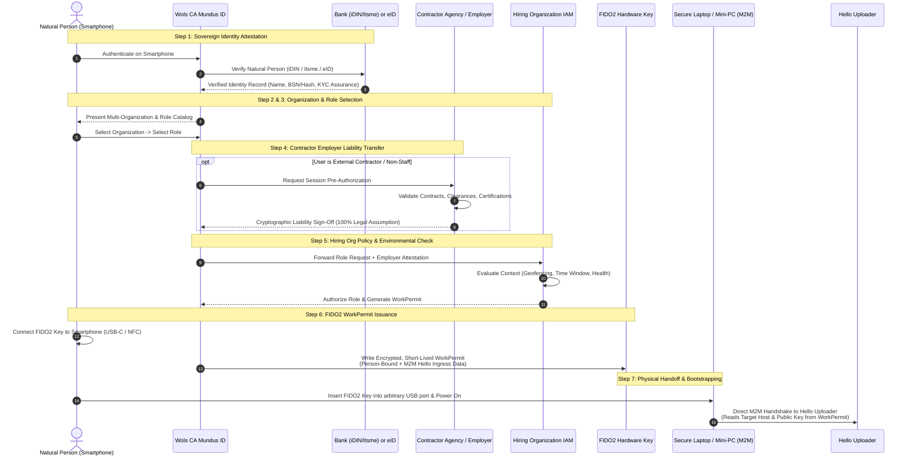

# Wols CA Identity Governance: The Natural Person, Multi-Organization Federation & Role Delegation

> **Authoritative Ecosystem Reference**: See `Wols_CA_Standards/Documentation/Person_And_Roles.md` for the single source of truth standard.

## 1. Executive Summary & Core Identity Philosophy
In traditional enterprise Identity and Access Management (IAM), user identity is tightly coupled to corporate Active Directory / Entra ID accounts, leading to credential sprawl, shared account abuse, and weak identity verification.

Wols CA enforces a fundamental paradigm shift: **Decoupling the Verified Natural Person from Enterprise Roles and Ephemeral Workspaces**. 

Identity assurance is established through out-of-band sovereign digital identities, multi-organization federated role discovery, statutory employer liability assumption for contractors, and hardware-bound **FIDO2 WorkPermits**.

---

## 2. The Two Classes of Electronic Identity (eID)

When a user initiates authentication on their smartphone, Wols CA supports two primary classes of identity providers via **Wols CA Mundus ID**:

```
+---------------------------------------------------------------------------------------------------+
|                                     WOLS CA MUNDUS ID GATEWAY                                     |
+---------------------------------------------------------------------------------------------------+
|                                                                                                   |
|  [ CLASS 1: BANK-BACKED IDENTITIES ]              [ CLASS 2: EUROPEAN eID / eIDAS 2.0 ]           |
|  • iDIN (The Netherlands)                         • National eID (e.g., DigiD, Itsme, BankID)     |
|  • Itsme (Belgium / Enterprise Banking)           • Qualified eIDAS 2.0 Digital Wallets           |
|  • Strict ongoing KYC / AML Banking Validation    • Government Identity Assurance                 |
|                                                                                                   |
|  ==> MANDATORY / STRONGLY PREFERRED FOR           ==> ACCEPTED FOR INTERNAL / CONFIDENTIAL        |
|      LEVEL 5 (TOP SECRET) WORKLOADS                   WORKLOADS (LEVEL 2 - 4)                     |
+---------------------------------------------------------------------------------------------------+
```

### 2.1 Class 1: Bank-Backed Identities (iDIN / Itsme)
* **High-Assurance Banking KYC**: Bank-verified identities are subject to rigorous, continuous Anti-Money Laundering (AML) and Know-Your-Customer (KYC) regulatory compliance, in-person passport verification, and daily active bank account monitoring.
* **Mandatory for Top Secret (Level 5)**: Because of continuous financial institution attestation, Wols CA **mandates or strongly prioritizes bank-backed identities for all Top Secret and mission-critical governance workloads**.

### 2.2 Class 2: European eID & eIDAS 2.0 Wallets
* **Governmental Assurance**: National eID systems (e.g., Belgian Itsme government tier, Nordic BankID, Dutch DigiD, and emerging eIDAS 2.0 EU Digital Identity Wallets).
* **Usage**: Permitted for Internal (Level 2), Confidential (Level 3), and Sensitive (Level 4) operational profiles based on organizational policy.

### 2.3 Natural Person Identifier (NPI) vs. Sovereign MundusID & Multi-NPI Binding
* **The Legal EU Natural Person Identifier (NPI)**:
  * The **Natural Person Identifier (NPI)** is a statutory identifier legally regulated and defined by the European Union (e.g. under eIDAS / EU digital identity regulations) and national legislations.
  * The European Union and national authorities have the statutory power to change, evolve, or restructure the syntax, length, and format of the Natural Person Identifier over time (as demonstrated by historical European and national identity transformations).
  * The NPI strictly retains whatever format, structure, or encoding is legally mandated by the EU or national governments.
* **Sovereign MundusID (Adhering to Database Laws)**:
  * MundusID is **fundamentally distinct from the legal NPI** (the previous conceptual equivalence of NPI = MundusID is decoupled).
  * MundusID maintains its own sovereign, persistent identifier (`mundus_id`, formatted as a standardized, collision-resistant hexadecimal string, e.g. `4A8F9C1E2B3D4F5A6B7C8D9E0F1A2B3C`) that strictly complies with all relational and distributed **database laws** (canonical primary keys, B-tree/LSM indexing efficiency, strict normalization, immutability, and zero external syntactic dependencies).
  * MundusID is the authoritative sovereign identifier used to federate across enterprise organizations, relying parties, systems, and persons.
* **1-to-Many / Multi-NPI Binding (The Person Remains the Exact Same Person)**:
  * MundusID is engineered to link and map **multiple different Natural Person Identifiers (NPIs) to one single sovereign MundusID**:
    1. Multiple national NPIs across different EU member states for individuals holding dual or multiple European nationalities.
    2. Changing or evolving NPI formats when the European Union or national authorities update their statutory identity schema.
    3. Document and credential renewals at national identity registers.
  * Because MundusID binds these diverse external identifiers to one sovereign MundusID anchor, **the human person remains the exact same unified person throughout their entire lifetime**, regardless of divergent, evolving, or restructured European Natural Person Identifiers.
* **Immutable Provenance & Multi-Nationality Ledger**: All linked NPIs, nationality records, and statutory updates are recorded in the sovereign identity linkage ledger with qualified QTSP timestamps and Merkle-tree audit logging, ensuring the legal and cryptographic provenance can always be verified without disrupting internal database schemas.

### 2.4 Data Minimization: MundusID-Only Federation & Source-First Attribute Assertion (Name, Age)
* **Default MundusID-Only Federation**: In principle, Wols CA federates **exclusively with the sovereign MundusID** (`mundus_id`) and **zero additional personal data, legal NPIs, or secondary attributes**, adhering strictly to the GDPR/AVG data minimization principle. Relying parties interact solely with `mundus_id` and remain completely insulated from underlying EU NPI format churn.
* **Selective Disclosure of Personal Attributes & Relying Party Licensing Gate (Name & Age / 18+ Retail Verification)**:
  * The architecture supports the capability to selectively release or assert verified identity attributes, specifically the natural person's **Full Name** and **Age / Age Claims** (e.g., verifying an 18+ age mandate when checking out for age-restricted purchases such as a bottle of liquor).
  * **Mandatory Relying Party Permit/License Verification at Source**: Attribute assertions and proofs are never granted indiscriminately to arbitrary requesting parties. To request an attribute assertion, relying parties (e.g. merchants, corporate employers, age-restricted venues) must hold an active statutory permit, sector license, or recognized accreditation registered in their enterprise federation profile. Mundus ID automatically verifies this enterprise license or permit online directly against the authoritative regulatory source register (e.g., municipal alcohol licensing boards, gambling authority databases, KvK) in real time before releasing any attribute assertion.
  * The relying party/merchant receives strictly the verified boolean claim (`age >= 18 = true`) without learning the customer's exact date of birth, citizen service number (BSN), or home address.
* **Direct Retrieval at Authoritative Source (iDIN / Itsme / eID)**: Whenever attributes (such as name or age) are authorized for release, they are **fetched in real time directly at the authoritative source** (via regulated banking identities **iDIN**, **Itsme**, or government-backed **eID / eIDAS 2.0 Wallets**). Mundus ID never creates a centralized database or permanent cache of these attributes, preventing centralized data breach risks and ensuring source freshness.
* **Pending Governance & Policy Determination**: A formal governance decision is pending regarding the exact scope, conditions, and operational contexts under which name and age claims may be released.
* **Source ID Change Management & Relying Party Shielding**:
  * When a citizen's underlying credentials, passport numbers, civil records, or banking authentication identifiers change at the authoritative source, the Mundus ID source adapter layer correctly ingests and reconciles these updates.
  * **Relying Party Abstraction**: Relying parties (afnemers of MundusID, such as merchants, corporate employers, or web services) remain **completely shielded and insulated** from external ID numbering changes, document renewals, or source credential migrations, preserving uninterrupted sovereign identity continuity and deterministic verification.
* **Transparent Identifier Format Evolution & Resilient Data Model**:
  * Should the internal format, schema, encoding, or representation of the ID itself evolve over time (as has occurred historically across identity frameworks), this transition remains **100% transparent** to both enterprise organizations and private individuals.
  * The agile **MundusID data model** natively accommodates and facilitates format evolutions without requiring breaking changes, database re-indexing, or migration downtime at relying organizations.

---

## 3. The 6-Step End-to-End Authentication & WorkPermit Workflow

The complete journey from human intent to secure workstation execution follows a deterministic 6-step lifecycle:



---

## 4. Key Governance Pillars

### 4.1 Multi-Organization Role Discovery & SBYOD
* A single verified natural person (e.g., a board member serving across multiple corporations, or a specialist consultant) has access to a centralized directory in Mundus ID.
* The user selects **Organization First**, then **Role Second**.
* Only **one Golden Image / workspace** executes on the physical hardware at any given time (single-tenant execution). Switching roles or organizations mandates a full session termination, power cycle, and fresh out-of-band attestation.

### 4.2 Contractor Governance & Statutory Employer Liability Transfer
* **The Legal Challenge**: When an organization hires external contractors, verifying in real-time whether the individual maintains valid certifications, active background checks, valid insurance, and unrevoked employment status creates immense compliance overhead.
* **The Wols CA Solution**:
  * Before a contractor can obtain a client WorkPermit, authentication routes through their **primary employer / consulting agency**.
  * The employer's automated IAM system signs a cryptographic assertion that **contractually and legally assumes 100% statutory liability** for the contractor's credentials and compliance at that exact second.
  * The hiring client can legally rely on this guarantee without audit friction or third-party liability exposure.

### 4.3 Person-Bound FIDO2 WorkPermit & M2M Bootstrapping
* **Person-Bound Enforcement**: The WorkPermit written to the FIDO2 hardware key is cryptographically bound to the specific natural person verified in Step 1. When the laptop boots, the user at the keyboard must match this identity via facial recognition and vital-sign presence.
* **M2M Bootstrapping Parameters**: The WorkPermit contains the target **Hello Uploader network address, session nonce, and Hello public key**. For the Secure Laptop, the physical FIDO2 Key is the sole and mandatory path (completely excluding FirstContact discovery), enabling the endpoint firmware to connect directly and securely to the high-assurance `Hello Uploader`.
* **Pre-Boot Exclusivity**: The FIDO2 WorkPermit is valid strictly during the pre-boot admission sequence. It cannot be used to elevate privileges or execute commands on an already-running computer.
