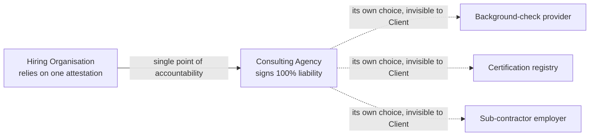

# Who We Are, How We Work, How We Deliver: The Wols CA Half-Product Delivery Model

| | |
|---|---|
| **Purpose** | The narrative that explains to clients, partners, auditors and our own engineers **why Wols CA deliberately delivers half-products instead of complete solutions**, how a half-product is completed with the standards of the target organisation, and which working principles (simplicity, supportability, event-driven administration, single point of accountability, implementation by the organisation itself) follow from that choice. |
| **Audience** | Owner, Architect, Subject Matter Expert, Product Owner, Business Analyst; client CIO / CISO / enterprise architects and procurement; partner integrators. |
| **Status** | Draft — Owner decision 2026-10-28, wording pending Architect / SME confirmation. Normative where marked **MUST / MUST NOT**; otherwise explanatory. |
| **Related** | [Wols_CA_Core_Architecture.md](Wols_CA_Core_Architecture.md) §1 (Source Code Custody), §2 tenets 4, 5, 7 and 8 · [Architecture_General_IT_Principles.md](Architecture_General_IT_Principles.md) (P2 Orthogonality, P3 Singularity, P4 Thrift, P7 Transparent, P9 Openness) · [Person_And_Roles.md](Person_And_Roles.md) §2.5, §2.8, §4.2 · Glossary: [Half-Product](Glossary.md#half-product), [Single Point of Accountability](Glossary.md#single-point-of-accountability), [Solution Baseline](Glossary.md#solution-baseline) |
| **Last reviewed** | 2026-10-28 |

---

## 1. Who We Are

Wols CA is a small, specialised engineering and advisory practice that builds **high-assurance security, identity and HSSE building blocks** for organisations that already have an IT landscape, an enterprise architecture, a procurement function and a support organisation of their own.

We are **not** a product vendor that wants to own a client's stack, and we are **not** a system integrator that wants to run a client's implementation. We are the specialist that brings the one missing, hard-to-build part — and then steps back.

This self-image is the root of every rule in this document.

---

## 2. Why We Deliver Half-Products, Not Complete Solutions

### 2.1 The problem with "complete solutions"

Every organisation of any size already has its **own standards**: an approved hypervisor, an identity provider, a directory, a SIEM, a laptop chassis, a crypto library, a network vendor, a ticketing process. Those standards were chosen for good reasons and are embedded in contracts, training, monitoring and audit trails.

A vendor that delivers a *complete* solution inevitably brings its own choices for those same elements. Wherever the vendor's choice differs from the organisation's standard, the organisation ends up with **one more product** — and that is never free:

| Consequence of "yet another complete product" | Why it hurts |
|---|---|
| **Procurement becomes more complex** | A second contract, licence model, renewal cycle and vendor assessment for a capability the organisation already has in another form. |
| **Support becomes more complex** | Two tools for one job, two sets of run-books, two on-call skill sets, two patch cadences. |
| **Dependency on the supplier grows** | The organisation can no longer replace or exit one element without unravelling the whole package (vendor lock-in — treated as a critical architectural failure in Core Architecture tenet 4). |
| **Harder to fit into the enterprise architecture** | The package bypasses the organisation's reference architecture, naming, logging and identity conventions; every integration becomes an exception. |
| **Duplicate — and therefore inconsistent — results** | Two systems hold overlapping truths (two user stores, two device registries, two audit logs). They drift apart, and the inconsistency itself becomes a security and compliance risk. |

### 2.2 The Wols CA answer: the half-product

Wols CA therefore **builds half-products only**: well-defined, self-contained building blocks that deliberately leave open every element for which the target organisation already has a standard.

A half-product is **completed with the standard choices of the target organisation** — their hypervisor, their IdP, their SIEM, their chassis, their crypto library — within the [Solution Baseline](Glossary.md#solution-baseline) of the relevant specification (Core Architecture tenet 7: *Existing Standards First, Organisation Decides*).

The result for the organisation:

* **Faster and cheaper to fit in** — no parallel product to procure, train for or support; the block lands inside the existing architecture, not beside it.
* **A flexible migration path** — because every open element is the organisation's own, each can be migrated, upgraded or replaced on the organisation's timetable, one element at a time, without touching the half-product.
* **One truth instead of two** — the half-product consumes and produces the organisation's own records (identity, devices, logs); it never keeps a competing copy.

```
+---------------------------------------------------------------------------------------------------+
|                           HALF-PRODUCT COMPLETED BY THE ORGANISATION                              |
+---------------------------------------------------------------------------------------------------+
|                                                                                                   |
|   WOLS CA DELIVERS (the hard, specialised part)       ORGANISATION SUPPLIES (its own standards)   |
|   -------------------------------------------         -------------------------------------       |
|   Specification + source code (handed over)      <->  Hypervisor, OS images, chassis              |
|   Cryptographic / identity / HSSE core logic     <->  Identity provider, directory, PKI farm      |
|   Attested invariants (Solution Baseline)        <->  SIEM, monitoring, ticketing, run-books       |
|   Qualification criteria for every open element  <->  Procurement, support, change process       |
|                                                                                                   |
|   Guardrail: the organisation's choice may NARROW the baseline, never WIDEN it (tenet 7).         |
+---------------------------------------------------------------------------------------------------+
```

### 2.3 What a half-product MUST and MUST NOT be

* A half-product **MUST** state, per open element, the **qualification criteria** an organisation standard has to meet (the Solution Baseline), so that completing it is a checklist and not a negotiation.
* A half-product **MUST** be delivered with its **complete source code** (Core Architecture §1, *Absolute Mutual Trust & Source Code Custody*) so that the organisation can maintain and rebuild it without Wols CA.
* A half-product **MUST NOT** duplicate a capability the organisation already has (no second user store, device registry, log store or scheduler) — see P3 Singularity and P4 Thrift in [Architecture_General_IT_Principles.md](Architecture_General_IT_Principles.md).
* A half-product **MUST NOT** depend on a specific vendor for any open element; where Wols CA names a preferred part (e.g. a vault microcontroller), it is a *default*, and qualified alternatives are listed.

**Worked examples already in the standards**

| Half-product | Deliberately left open — completed by the organisation |
|---|---|
| Secure Laptop hardware vault (`Wols_CA_SecureLaptop.md` Part IV) | Vault silicon class (MCX N947 / RW612 / qualified drop-ins) chosen by the using organisation through its `vault_policy`; laptop chassis, Proxmox host image and SIEM are the organisation's. |
| Mundus ID MatchQuery (`Person_And_Roles.md` §2.5) | The organisation supplies the identity data **it already holds**; Mundus ID only confirms or denies. No attribute store is created beside the organisation's HR system. |
| Zero-Trust uploader mesh (`Architecture_ZeroTrust.md`) | TLS library (wolfSSL or OpenSSL), broker hosting, network zoning hardware and monitoring are organisation standards; Wols CA delivers the protocol logic and the invariants. |

---

## 3. How We Work: Simplicity and Supportability First

* **We search for the simplest solution that meets the requirement** — not the most complete, not the most elegant. A function that is not typical to the system's purpose is left out even when it would cost nothing to add (P4 Thrift).
* **Every design is judged on how optimally it can be supported** by the organisation's *existing* support staff with their existing tools: clear state machines, English-only logs and diagnostics, deterministic behaviour (no hidden timers, no retained state), and documentation written for the engineer on call rather than for the author.
* **Readability over cleverness** — the same rule we apply to code (beginner-clear, explicit, no esoteric constructs) applies to architecture: if it needs a specialist to explain, it is not finished.

---

## 4. How We Administer: Simple Configuration That Reflects Every Change Immediately

Authorisation decisions are only as good as the information they are based on. Wols CA therefore aims for an **administration and configuration model that is simple enough to be kept correct, and that processes every change concerning the system immediately**:

* **Event-driven, not batch-driven** — a joiner, mover, leaver, device swap, role change, contract end or policy change is an *event* that is processed the moment it occurs (Core Architecture §5; HSSE testbed rule "zero OS timers, event-driven"). There is no nightly synchronisation window during which an authorisation decision can be taken on stale data.
* **One record per fact** — each fact (who, which device, which organisation, which role, which policy) lives in exactly one place and is referenced, never copied (ties to §2.1 "duplicate and inconsistent results").
* **Adequate authorisation decisions** — because the decision engine always sees the current state, it can refuse, narrow or revoke at once (fail-closed) instead of discovering the discrepancy at the next audit.
* **Configuration is small and declarative** — a policy such as `vault_policy` or a device-role assignment is a short, reviewable record, not a code change.

---

## 5. Accountability: One Logical Party, One Point of Contact

### 5.1 Liability for correct information lies with the best logical party

Wols CA places the **accountability for the correctness of a piece of information with the party that is logically best placed to know and to guarantee it** — and with that party alone:

* the **employer / consulting agency** guarantees the employment, clearances and certifications of its contractor (Statutory Employer Liability Transfer, `Person_And_Roles.md` §4.2);
* the **authoritative identity source** (bank, eID scheme) guarantees the natural person; Mundus ID never re-asserts it;
* the **device owner organisation** guarantees the hardware lifecycle of its fleet (ledger 1); the **workload / client organisation** guarantees the session and user audit of its own image (ledger 2).

### 5.2 Single point of accountability, transparent delegation

The party that *relies* on information **MUST deal with exactly one accountable counterpart** for it — a [Single Point of Accountability](Glossary.md#single-point-of-accountability). That counterpart may itself rely on further parties (sub-contractors, sub-processors, its own suppliers), but:

* that delegation is **fully transparent to the party above**: the relying party sees one answer, one signature, one liability, and never has to involve or contract the parties underneath;
* the accountable counterpart **cannot push liability downward** towards the relying party by pointing at its own suppliers; it carries the chain it chose.



This is why Wols CA never designs a process in which several organisations have to be **directly** involved to establish one fact: multi-party involvement multiplies procurement, contracts and dispute paths and dilutes accountability until nobody is liable.

---

## 6. How We Deliver: The Target Organisation Implements

Wols CA **deliberately lets the target organisation implement the half-product itself**.

* The organisation knows its own landscape, change process, people and politics; an external party is — and remains — the *odd one out* inside it. The organisation's own staff can integrate, roll out and support a building block in their own environment better than we can.
* Implementation by the organisation is the only way to guarantee that **the knowledge stays** where the system runs (Core Architecture §1: source code handed over upfront; §3: operational sovereignty independent of Wols CA's availability).
* Wols CA's role during implementation is **advisory and verifying**: we answer, review, help qualify organisation standards against the Solution Baseline and confirm that attested invariants hold. We do not take the keyboard, and we do not become a dependency in the organisation's run-book.
* The organisation **decides**, within the baseline (tenet 7). Where the organisation asks Wols CA to deviate from the baseline, the answer is a documented refusal with the reason, not a quiet exception.

---

## 7. Summary of Principles (normative checklist)

| # | Principle | One-line test for a design review |
|---|---|---|
| D1 | **Half-products only** | Does the design leave every element for which the organisation has a standard open, with qualification criteria? |
| D2 | **Completed with the organisation's standards** | Is every open element filled by an organisation standard (or a documented, better-fit Wols CA proposal the organisation accepted) within the Solution Baseline? |
| D3 | **No duplicate truths** | Does the design avoid any second store of a fact the organisation already holds? |
| D4 | **Simplicity and supportability** | Can the organisation's existing support staff run it with existing tools, and is anything present that is not required? |
| D5 | **Event-driven administration** | Is every change processed immediately so that the next authorisation decision uses current data? |
| D6 | **Best logical party is accountable** | Is each fact guaranteed by the party best placed to know it, and only by that party? |
| D7 | **Single point of accountability, transparent delegation** | Does the relying party deal with exactly one accountable counterpart, whose own sub-parties stay invisible to it? |
| D8 | **Organisation implements** | Is the implementation, roll-out and support owned by the organisation, with Wols CA advising and verifying only? |

Every architecture artefact (`/docs/arch/*.md`) is reviewed against D1–D8 in addition to the ten general principles of [Architecture_General_IT_Principles.md](Architecture_General_IT_Principles.md).
